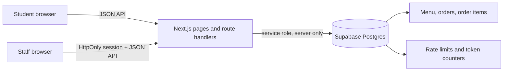

# Design

## Architecture



The browser calls Next.js routes only. Route handlers validate requests, apply rate/session/order-key checks, and then use a server-only Supabase client. API responses set `Cache-Control: no-store`. The health route returns only `{ "ok": true }` and does not disclose environment state.

## Components

| Component | Responsibility | Technology |
|---|---|---|
| Student menu and order tracker | Menu, cart, checkout, local order key storage, visible-tab polling | React client components, localStorage |
| Kitchen and admin screens | Staff queue, stock toggles, daily metrics | React client components |
| Route handlers | Validation, rate limiting, owner/session checks, serialization | Next.js App Router, TypeScript, Zod |
| Shared domain code | HMAC/hash/session helpers, estimator, time, status rules | Node crypto, jose, pure TypeScript |
| Database | Menu, orders, item snapshots, counters, atomic functions | Supabase Postgres, RLS |

## Data model

- `menu_items`: name, description, integer PKR price, prep time, availability.
- `orders`: order token/day, order-key hash, HMACed University ID, customer name, status, estimate, idempotency UUID, timestamps, step-back flag.
- `order_items`: order and menu references, snapshot item name, quantity, snapshot unit price.
- `token_counters`: atomic daily token sequence.
- `rate_limits`: atomic request windows. Scope prefixes are visible for lockout reset; identities remain HMACed.

All five tables enable RLS and have no policies. Browser roles have no table/function privileges. The SQL has not yet been applied to a live Supabase project.

## Status flow

```text
received -> preparing -> ready -> picked_up
    |           ^          |
    v           |          v
cancelled   step back   step back

received / preparing --45 min--> expired
ready --15 min--> expired
```

Student cancellation is allowed only from `received`. Staff updates include the expected prior status in the database update; a stale staff screen receives a conflict response with the current status. `picked_up`, `cancelled`, and `expired` are terminal.

## API surface

| Method | Endpoint | Purpose | Auth |
|---|---|---|---|
| GET | `/api/health` | Health signal | None |
| GET | `/api/menu` | Menu and stock state | None |
| POST | `/api/orders` | Create order; returns key once | Rate limits |
| GET | `/api/orders/[id]` | Read own order | UUID + `x-order-key` |
| POST | `/api/orders/[id]/cancel` | Cancel from Received | UUID + `x-order-key` |
| POST | `/api/staff/login`, `/logout` | Create/clear staff session | PIN / origin check |
| GET/PATCH | `/api/staff/orders`, `/orders/[id]/status` | Queue and status transitions | Staff JWT cookie |
| GET/PATCH | `/api/staff/menu`, `/menu/[id]` | Staff menu and stock status | Staff JWT cookie |
| GET | `/api/staff/analytics` | Today’s analytics in Karachi time | Staff JWT cookie |

## Key decisions and trade-offs

| Decision | Chosen | Reason | Trade-off |
|---|---|---|---|
| Student identity | No student login; use normalized HMACed ID plus order key | Keeps checkout short while limiting active orders | IDs are not verified; a lost key cannot be recovered |
| Live updates | Poll every 5 seconds only while the tab is visible | Simple to operate on a short event timeline | Less immediate than WebSockets; request volume is rate-limited |
| Order creation | Security-definer transaction with advisory lock and server-side menu prices | Keeps token, cap, idempotency, and insert atomic | Requires applying and reviewing the SQL in Supabase |
| Ready time | Deterministic queue estimator | Explainable and testable without AI | Work/station model is approximate; displayed as an estimate |
| Payment | Cash on pickup | Avoids payment provider setup and student financial data | No prepayment or in-app receipts |

## AI components

The product does not use AI to set ready times. The estimator is deterministic. No Gemini feature is currently implemented.

## Security and privacy

- Threats considered: guessed order IDs/keys, duplicate submissions, concurrent status changes, PIN brute force, browser access to Supabase, unsafe user text, cache leakage, and service error disclosure.
- Order keys have 256 bits of randomness; only SHA-256 hashes are stored. University IDs are HMAC-SHA256 values. Staff/admin payloads exclude customer name and University ID.
- Staff PINs are scrypt checked, rate-limited by IP and globally, and never placed in client code. Sessions use signed HS256 cookies with HttpOnly, SameSite=Strict, and Secure in production. Origin mismatch returns 401.
- Current limitations: the SQL and routes have not been integration-tested against a live Supabase project; University IDs are not authenticated; browser storage loss means the key is lost.
